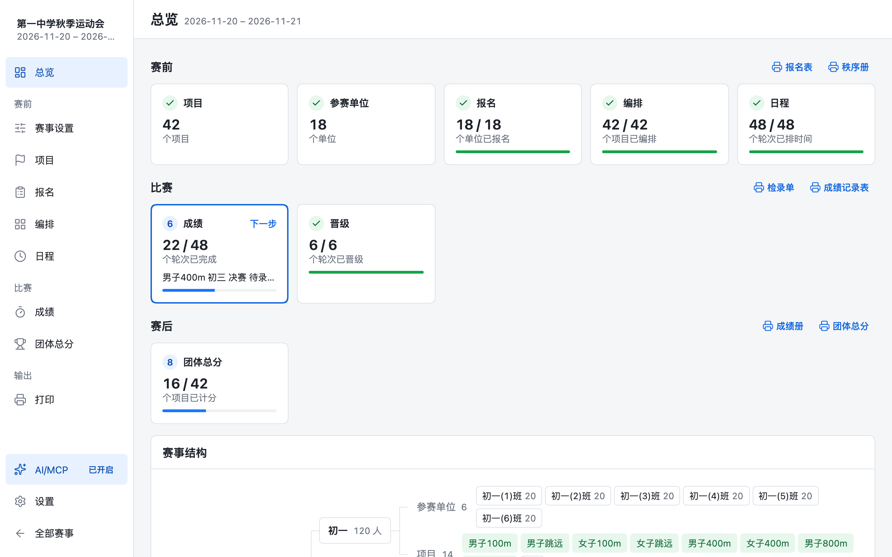
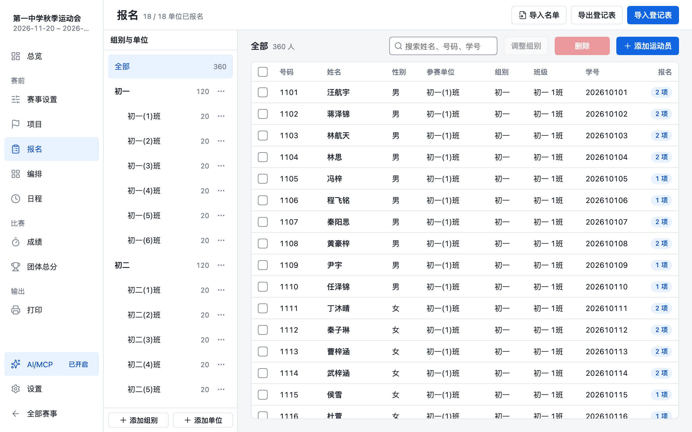
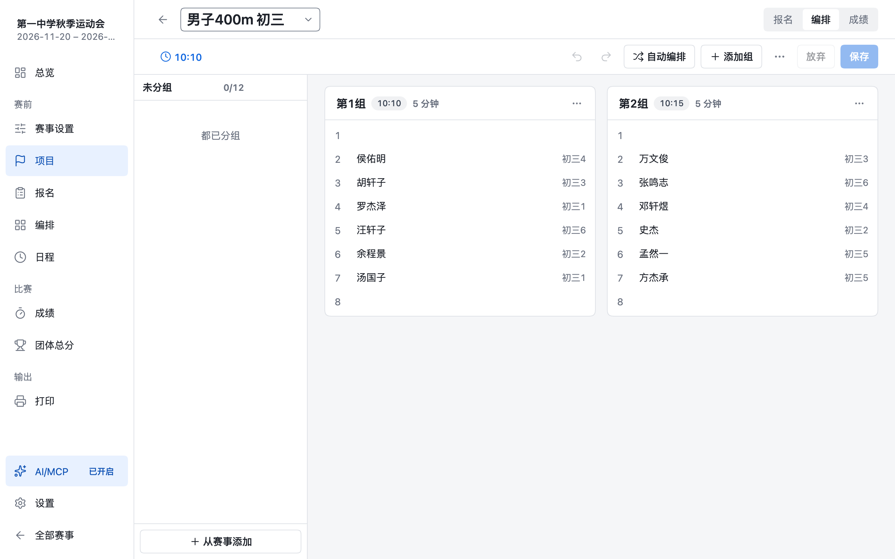
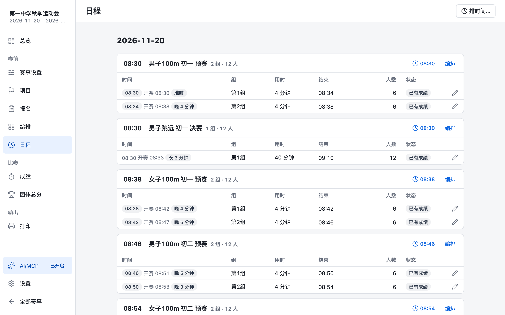
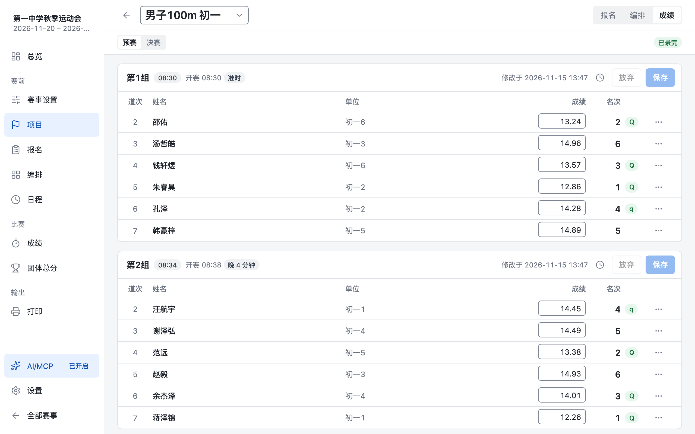
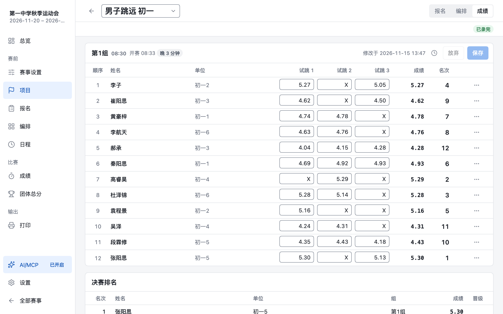
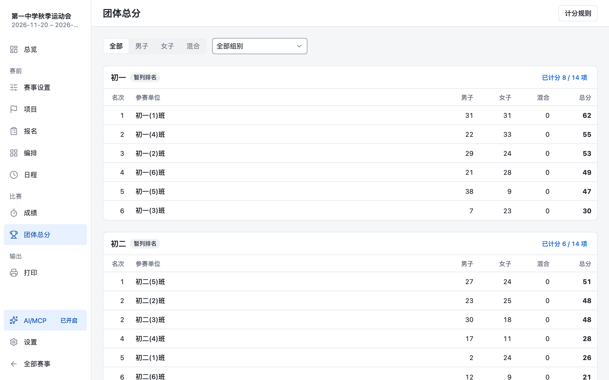
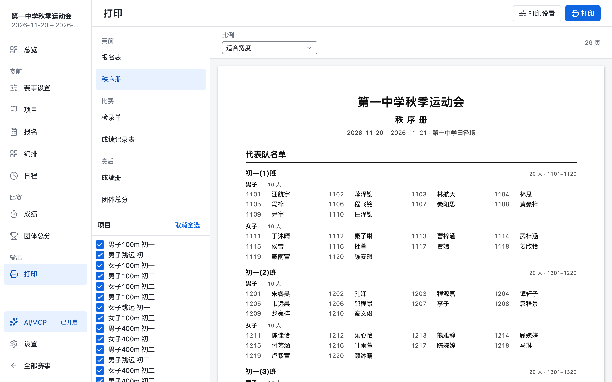
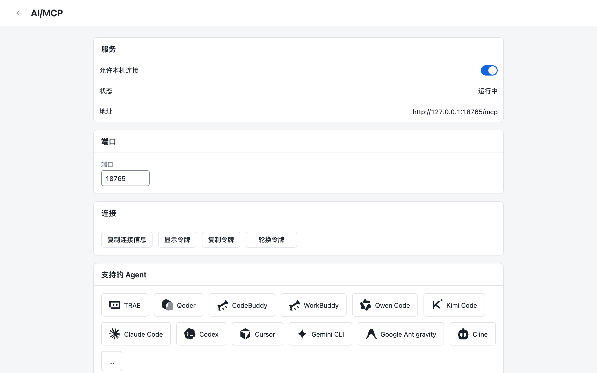

<div align="center">


# SportsMeet

**免费开源的田径与校园运动会编排系统**

报名、编排、秩序册、录入成绩、排名、成绩册，一台电脑完成。单机离线，数据只在本机。

[](https://github.com/stmtc233/SportsMeet/releases)
[](https://github.com/stmtc233/SportsMeet/actions/workflows/check.yml)
[](LICENSE)


[官网](https://stmtc233.github.io/SportsMeet/) · [使用文档](https://stmtc233.github.io/SportsMeet/docs.html) · [下载](https://github.com/stmtc233/SportsMeet/releases) · [反馈问题](https://github.com/stmtc233/SportsMeet/issues)

<br>

<picture>
  <source srcset="website/assets/overview-dark.png" media="(prefers-color-scheme: dark)">
  
</picture>

</div>

## 特点

- **一条流程走到底**：赛事 → 报名 → 编排 → 秩序册 → 录入成绩 → 排名 → 成绩册，总览页标出每一段的进度和下一步。
- **单机离线**：不用服务器、不用注册、不用联网，数据存在本机的 SQLite 文件里，升级前自动备份。
- **为校运会设计**：年级组别、班级参赛单位、报名登记表下发回收、团体总分按年级分榜，35 个常用项目开箱即用。
- **规则靠得住**：名次、并列、晋级、全能积分、团体得分全部由程序计算，有成绩的组自动锁定，每次改动都记操作日志。
- **打印即所见**：报名表、秩序册、检录单、成绩记录表、成绩册、团体总分表按 A4 分页预览，续页与页码都排好。
- **AI 助手可接入**：内置本机 MCP 服务，Claude Code、Cursor、Codex 等 AI 助手可以帮你导入名单、编排、排时间、录成绩。
- **开放、免费**：MIT 协议，所有功能都能用，不限赛事、项目和人数；赛事可导出为[公开格式](docs/interchange-format.md)的 JSON。

## 功能一览

<table>
  <tr>
    <td width="50%" valign="top">
      <picture>
        <source srcset="website/assets/entries-dark.png" media="(prefers-color-scheme: dark)">
        
      </picture>
      <p><b>报名</b>：按组别与单位管理运动员，报名登记表下发给各班、填好后一次导入；也可从表格粘贴名单。超项、超额即时提示。</p>
    </td>
    <td width="50%" valign="top">
      <picture>
        <source srcset="website/assets/arrange-dark.png" media="(prefers-color-scheme: dark)">
        
      </picture>
      <p><b>编排</b>：自动分组排道，同单位尽量分开、各组人数均衡；拖动微调后一次保存。支持预赛、次赛、半决赛、决赛。</p>
    </td>
  </tr>
  <tr>
    <td width="50%" valign="top">
      <picture>
        <source srcset="website/assets/schedule-dark.png" media="(prefers-color-scheme: dark)">
        
      </picture>
      <p><b>日程</b>：多个轮次连着排时间，一次定好间隔与预计用时；同一运动员时间重叠或休息不足时提示，并记录实际开赛时间。</p>
    </td>
    <td width="50%" valign="top">
      <picture>
        <source srcset="website/assets/results-dark.png" media="(prefers-color-scheme: dark)">
        
      </picture>
      <p><b>径赛成绩</b>：录入即出名次，按名次（Q）与成绩（q）晋级，并列由裁判裁定先后。</p>
    </td>
  </tr>
  <tr>
    <td width="50%" valign="top">
      <picture>
        <source srcset="website/assets/field-dark.png" media="(prefers-color-scheme: dark)">
        
      </picture>
      <p><b>田赛成绩</b>：远度逐次录入、取最好成绩；高度逐杆记录 O / X / –，自动判断下一跳。</p>
    </td>
    <td width="50%" valign="top">
      <picture>
        <source srcset="website/assets/team-scoring-dark.png" media="(prefers-color-scheme: dark)">
        
      </picture>
      <p><b>团体总分</b>：按决赛名次换算得分，各组别分别给参赛单位排名；分值、并列规则、接力与全能倍数可自定义。</p>
    </td>
  </tr>
  <tr>
    <td width="50%" valign="top">
      <picture>
        <source srcset="website/assets/reports-dark.png" media="(prefers-color-scheme: dark)">
        
      </picture>
      <p><b>打印</b>：秩序册（含代表队名单、竞赛日程表，可紧凑排版）、检录单、成绩记录表、成绩册，预览就是纸上的样子。</p>
    </td>
    <td width="50%" valign="top">
      <picture>
        <source srcset="website/assets/mcp-dark.png" media="(prefers-color-scheme: dark)">
        
      </picture>
      <p><b>AI/MCP</b>：复制连接信息给 AI 助手即可使用。只接受本机连接，批量改动先预览、确认后才写入。</p>
    </td>
  </tr>
</table>

### 支持的项目

| 类型 | 例子 | 成绩录入 |
|---|---|---|
| 径赛 | 100m、400m、1500m、110m栏 | 计时，分道 / 不分道 / 分道后抢道 |
| 接力 | 4×100m、4×400m | 按队报名，名单按棒次排列 |
| 远度 | 跳远、立定跳远、铅球、实心球、标枪 | 逐次录入，取最好成绩 |
| 高度 | 跳高、撑竿跳高 | 逐高度记录试跳 |
| 计次 | 跳绳、集体跳绳、定点投篮 | 一次 / 取最好 / 求和 |
| 计分 | 技巧评分 | 小数位与名次方向可设 |
| 全能 | 自定义分项，如校园三项全能 | 统一报名，按计分表换算积分 |

## 下载安装

到 [Releases](https://github.com/stmtc233/SportsMeet/releases) 下载对应系统的文件：

| 系统 | 安装包 | 便携版（解压即用） |
|---|---|---|
| Windows 10 / 11 | `sportsmeet-setup-<版本>-amd64.exe` | `…-windows-amd64-portable.zip` |
| macOS 12 及以上（Intel 与 Apple 芯片） | `sportsmeet-<版本>.dmg` | `…-darwin-universal-portable.zip` |
| Linux x86-64 | `.deb`、`.rpm` | `…-linux-amd64.tar.gz` |

已安装的应用会在有新版本时提示更新，更新文件经过签名校验。

## 快速上手

1. **新建赛事**：填写名称、日期与地点，或沿用往届赛事的项目与赛制。
2. **赛事设置**：设定报名限制、团体计分规则、检录提前时间等。
3. **项目**：从 35 个常用项目预设里勾选，或自定义项目与轮次。
4. **报名**：建好组别与参赛单位，导出报名登记表发给各单位，收回后导入。
5. **编排与日程**：在「编排」页批量自动编排，在「日程」页排好每个轮次的时间。
6. **打印秩序册**：在「打印」页选择秩序册，预览后打印。
7. **比赛日**：在「成绩」页按时间顺序录入，名次、晋级与团体总分自动更新。
8. **赛后**：打印成绩册与团体总分表，导出赛事文件存档。

每一步的详细说明见[使用文档](https://stmtc233.github.io/SportsMeet/docs.html)。

## 让 AI 助手帮忙

SportsMeet 内置本机 [MCP](https://modelcontextprotocol.io) 服务，默认开启。打开「AI/MCP」点「复制连接信息」，配置到支持 Streamable HTTP 的客户端即可，例如：

> 把这张 Excel 里的初二报名名单导入到秋季运动会，然后给所有径赛项目自动编排，从 11 月 20 日 8:30 开始排时间。

- 只监听 `127.0.0.1`（默认端口 18765），使用独立 Bearer 令牌，拒绝非本机来源。
- 查询可直接调用；批量操作、删除、覆盖已有成绩须先预览，用户确认后才写入。
- 名次与晋级始终由应用计算，AI 不能直接指定；已有成绩的数据不能经 MCP 删除。

工具目录与边界见 [MCP 说明](docs/agents/mcp.md)。

## 开发

技术栈：[mygo](https://github.com/egoist/mygo)（Go + 系统 WebView）· Go · SQLite · React · TypeScript · Vite · Bun。

需要 Go（版本见 `go.mod`，本机较旧时自动下载）与 Bun：

```sh
bun install
bun run dev        # 打开应用窗口并热更新
bun run build      # 打包，产物在 build/<平台>/
bun run check      # 提交前检查：go vet、Go 单测、类型检查、前端单测、设计系统检查
```

页面冒烟测试需先 `bunx playwright install chromium`，再运行 `bun run test:ui`。完整检查命令与跨平台验证范围见[验证范围](docs/verification.md)。

```
前端 React ──(mygo 绑定)──▶ internal/bind ──▶ internal/service ──▶ store / arrange / scoring
AI 助手 ──(本机 MCP)──────▶ internal/mcp  ──▶ internal/service
```

所有写入都经过 `internal/service` 统一校验、记录操作日志并通知界面刷新。代码结构、术语与设计约束见 [AGENTS.md](AGENTS.md)。

### 文档

| 文档 | 内容 |
|---|---|
| [使用文档](https://stmtc233.github.io/SportsMeet/docs.html) | 面向赛事工作人员的操作说明 |
| [交换格式规范](docs/interchange-format.md) | 赛事 JSON 文件格式与 [JSON Schema](docs/schema/) |
| [性能](docs/performance.md) | 大型赛事的压测与优化记录 |
| [品牌规范](docs/brand-guidelines.md) | 「跑道 S」标识与 [品牌资源](resources/brand/) |
| [AGENTS.md](AGENTS.md) | 架构、术语与不变量，AI 协作工具与贡献者必读 |

官网是 `website/` 下的静态页面，无需构建，直接打开即可预览；发布到 GitHub Pages 时，下载区自动换成最新 release 的链接。

## 路线图

- [ ] 号码布：按参赛单位分段自动编号并打印
- [ ] 风速录入：径赛整组风速、远度逐次风速
- [ ] 破纪录标记：赛事纪录表与成绩册标注
- [ ] 奖状打印与打印样式预设

## 参与贡献

欢迎通过 [Issues](https://github.com/stmtc233/SportsMeet/issues) 反馈问题或提出建议。提交代码前请阅读 [AGENTS.md](AGENTS.md)，并确保 `bun run check` 通过。

## 协议

[MIT](LICENSE)，免费使用、修改和分发。
