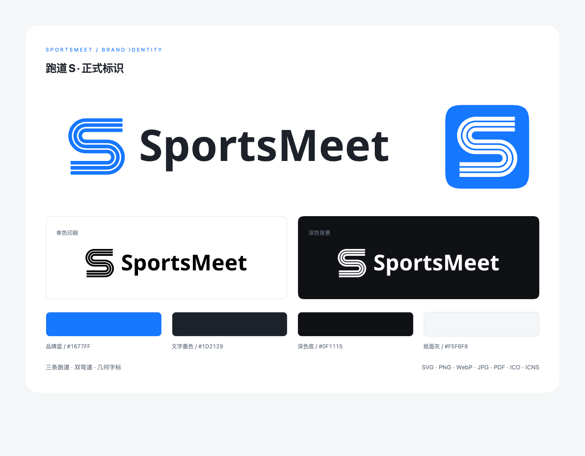

# SportsMeet 标识与应用规范



## 标识

标识称为「跑道 S」：三条平行跑道组成 SportsMeet 的首字母 S，两段弯道连接两端直道。图形表达田径，等距的线条表达赛事编排的秩序。

品牌名称统一写作 **SportsMeet**，大小写固定。标识只使用图形与名称，不附加口号。应用与官网使用相同的图形与品牌蓝。

## 母版与几何

参数事实源是 [identity.json](../resources/brand/source/identity.json)，字标路径保存在 [wordmark.json](../resources/brand/source/wordmark.json)。导出的 [标准图形](../resources/brand/svg/mark-blue.svg) 为封闭填充路径，不依赖描边缩放。所有文件均从同一母版生成。

| 项目 | 标准 |
|---|---|
| 图形画布 | 512 × 512 |
| 可见边界 | x、y 均为 34–478，可见宽高均为 444 |
| 跑道 | 3 条；线宽 28；中心距 40；净间距 12 |
| 弯道 | 上弯道中心为（172，172），下弯道中心为（340，340）；中线基准半径 84；各跑道保持同心 |
| 端点 | 平切；上端 x = 460，下端 x = 52 |
| 对称 | 绕（256，256）旋转 180° 后重合 |

在可见边界外，四周至少留 **56 单位**的安全空间，约为图形可见高度的 1/8。SVG 自带的 34 单位透明边距只用于导出对齐，放置时仍需补足安全空间。空间内不放文字、边框或其他图形。应用图标的内部留白由图标母版统一提供。

## 色彩

| 角色 | HEX | RGB | 用途 |
|---|---|---|---|
| 品牌蓝 | `#1677FF` | 22，119，255 | 主标、图标底色；与界面浅色主色一致 |
| 文字墨色 | `#1D2129` | 29，33，41 | 标准字标 |
| 深色底 | `#0F1115` | 15，17，21 | 反白标识的承托背景 |
| 纸面灰 | `#F5F6F8` | 245，246，248 | 展示背景 |
| 黑 | `#000000` | 0，0，0 | 黑白打印 |
| 白 | `#FFFFFF` | 255，255，255 | 深色底反白 |

主标使用纯色，无渐变、阴影或纹理。导出文件按 RGB 使用，PDF 同样为 RGB 矢量文件；需要 CMYK 时由印刷输出方按纸张与设备配置转换并打样，不指定通用 CMYK 数值。

## 字标与组合

字标基于 **Noto Sans Bold，700 字重**，名称为 SportsMeet，已转为矢量路径。使用交付的路径保持字形与间距一致，无须安装字体。中文说明沿用项目的系统字体栈，不组成标识。

| 组合 | 比例与用途 | 最小宽度 |
|---|---|---|
| 独立图形 | 应用图标、头像、空间较窄的入口 | 标准版 48px；小尺寸版 16px；印刷 10mm |
| 横式组合 | 图形可见高 160；图文间距 40；字标大写字高 88；用于导航、页眉 | 320px；印刷 70mm |
| 竖式组合 | 图形画布 512；字标大写字高 64；图形与字标水平居中；用于封面、展示 | 160px；印刷 40mm |

标准组合为蓝色图形与墨色字标。纯黑组合用于单色印刷，纯白组合用于纯色深底。反白 SVG、PNG 与 WebP 保持透明背景，预览时应放在深色底上。反白 JPG 自带深色底。

## 小尺寸与应用图标

- **16–32px** 使用 `mark-small-*` 或相应尺寸的图标。保持三条跑道，线宽为 24，中心距为 48，净间距为 24，使间隔在小尺寸下保持可辨。33–47px 使用标准版过渡，标准版的推荐最小宽度为 48px。
- **桌面图标**采用 1024 × 1024 透明画布，蓝色方形位于（100，100），尺寸为 824 × 824。角半径参数 204，轮廓以 `superellipse(1.78)` 采样为固定 SVG 路径；图形在画布中居中。直接使用交付图标，不再额外添加圆角遮罩。
- **16、24、32px 图标**使用更大的满幅蓝色承托与小尺寸图形，属于光学校正，不从 1024px 桌面图标机械缩小。
- **Apple Touch 与方形网页图标**使用不透明满幅蓝底，由目标系统裁切；不带桌面图标的透明外边距。
- **favicon**提供 SVG 与 ICO。ICO 含 16、24、32、48、64、128、256px；ICNS 同时含标准与 Retina 表示，最高为 1024px。

小图标与正文相邻时，用界面文字提供名称；不把跑道标识当作正文中的字母。白色图形置于品牌蓝上是图形应用，正文与按钮文字仍按设计系统的可读性要求选择颜色。

## 使用边界

- 等比例缩放，保持三条跑道与两段弯道；不拉伸、旋转或改变跑道数量。
- 使用导出的闭合路径；不额外描边、圆化端点、裁切弯道或调整字标间距。
- 浅底使用蓝色或黑色，深底使用白色；不把蓝色标识直接放到深色或低对比背景上。
- 复杂图片上提供纯色承托与安全空间；不把其他图形拼入标识。
- 品牌标识独立于 Lucide 功能图标，不替代页面操作图标。

## 文件索引

所有交付物位于 [resources/brand/](../resources/brand/)，文件名前缀为布局，后缀为颜色。

| 位置 | 内容 |
|---|---|
| `source/identity.json` | 几何、色彩与导出尺寸参数 |
| `source/wordmark.json` | 已转路径的字标及字体来源信息 |
| `svg/mark-{blue,black,white}.svg` | 标准独立图形 |
| `svg/mark-small-{blue,black,white}.svg` | 小尺寸独立图形 |
| `svg/{horizontal,stacked}-{blue,black,white}.svg` | 横式、竖式组合 |
| `svg/app-icon.svg` | 带透明边距的桌面图标矢量 |
| `png/` | 3 种布局 × 3 种颜色 × 512、1024、2048px 宽度，均为透明 PNG |
| `web/` | 各组合的透明 WebP、带底色 JPG、favicon、180px Apple Touch 与 192/512px 满底方形图标 |
| `icons/` | 16–1024px PNG、Windows ICO、macOS ICNS |
| `pdf/` | 3 个蓝色主标矢量印刷稿与 4 页视觉规范 |
| `preview.html` / `preview.png` | 品牌总览，浏览器版与图片版 |
| `guide.html` | 视觉规范的浏览器版 |
| `manifest.json` | 文件清单、字节数与 SHA-256，不包含自身与 ZIP |
| `sportsmeet-brand-assets.zip` | 整套资产及本文的打包文件 |

快速入口：[横式 SVG](../resources/brand/svg/horizontal-blue.svg)、[2048px 图形 PNG](../resources/brand/png/mark-blue-2048.png)、[应用 ICNS](../resources/brand/icons/app-icon.icns)、[应用 ICO](../resources/brand/icons/app-icon.ico)、[视觉规范 PDF](../resources/brand/pdf/brand-guidelines.pdf)、[整套下载](../resources/brand/sportsmeet-brand-assets.zip)。

## 导出与项目接入

```sh
bun install
bunx playwright install chromium
bun run brand:generate
```

导出脚本为 [scripts/generate-brand.mjs](../scripts/generate-brand.mjs)。需要项目已有的 Playwright Chromium 和 Python 3 标准库；不依赖在线服务、系统字体或额外的图像转换软件。可通过 `SPORTSMEET_BROWSER_PATH` 指定本机 Chromium。字标形状已固定在母版中，视觉规范正文使用本机中文系统字体。

重新导出会同步：

- `resources/icon.png`：mygo 默认读取的 1024px 应用图标。
- `website/assets/icon.png`：官网导航使用的 256px 图标。
- `website/assets/favicon.svg`、`favicon.ico`、`apple-touch-icon.png`：官网浏览器与触屏图标。

修改几何与色彩时先编辑 `source/identity.json`，再重新导出并同步本规范；不要单独修改导出图片，否则下次导出会被覆盖。新增导出文件需同步脚本与文件索引。

## 来源与许可

图形、导出脚本与项目其他原创资源遵循仓库 MIT 许可。字标使用 Noto Sans Bold 的轮廓，字体版权与完整 SIL Open Font License 1.1 文本见 [OFL-NotoSans.txt](../resources/brand/LICENSES/OFL-NotoSans.txt)。字标轮廓来源与许可也记录在 `source/wordmark.json`；完整字体文件不在交付包中。
